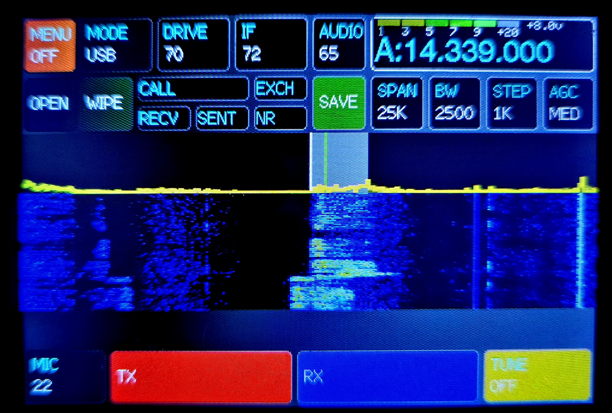

# zBitx Custom Software


Improved software for the **zBitx**, a 5‑watt QRP HF transceiver covering 80–10 meters. It runs on the radio's Raspberry Pi Zero 2 W (32‑bit Raspberry Pi OS) and works together with the matching [front‑panel firmware](https://github.com/drexjj/zbitxfrontpanel) on the Pico.

📖 **Operator manual:** [zBitx Wiki](https://github.com/drexjj/zbitx/wiki)
💬 **Help and discussion:** [Discord](https://discord.gg/tCCjw5g5Pf) · 📺 [YouTube](https://www.youtube.com/@radioelectronicshub)


## ✨ Features

- **One‑tap updates.** **Menu → UPDATE** on the front panel updates both the Pi software and the front‑panel firmware over WiFi. *(New in v5.15)*
- **TCI server** on port 50001: control, receive and transmit audio, I/Q and CW over one network connection for [SDR Oxide](https://github.com/dividebysandwich/sdroxide), JTDX, WSJT‑X Improved, MSHV and more. No cables or audio loopbacks needed. *(New in v5.15)*
- **HPSDR Protocol 1** receive panadapter feed for SparkSDR, SDR Console, Thetis and similar. *(New in v5.15)*
- **Web interface** on any phone, tablet or computer, with drag tuning, waterfall, FT8 decode lists, grid map, DX spots and voice transmit from your device's microphone.
- **[zBitx Remote](https://github.com/drexjj/zbitx-remote)** Android app, for operating at home, in the field over a phone hotspot, or anywhere with Tailscale.
- **FT8 on the radio itself:** tap‑to‑call QSOs, an ALL / CQ ONLY filter, and compound callsigns such as `PJ4/K1ABC`.
- **CW:** straight key, iambic A/B, ultimatic and bug keyers, plus macros.
- **Hamlib CAT** on port 4532 or over USB, for logging and digital‑mode software.
- **WiFi and USB‑mode control** from the front panel, and the Pi desktop in your browser through VNC.
- **[zBitx Toolbox](https://github.com/drexjj/zbitx-toolbox)** apps for automatic PA calibration, backups, log export and more.

See [release_notes.md](release_notes.md) for what changed in each version.


## 🚀 Getting Started

| Your situation | What to do |
|---|---|
| **Your radio already runs this software** | Update it: tap **Menu → UPDATE**. On older radios without that button, see [Upgrading the Software](https://github.com/drexjj/zbitx/wiki/Upgrading-the-Software) for the one‑time catch‑up. |
| **New radio, or starting fresh** | Write the preconfigured SD card image (below). |
| **You want to install onto an existing Pi OS** | See [Installing from source](#-installing-from-source). |

> **Updating is not reflashing.** An update keeps your settings, calibration, logbook and macros. Only writing a new SD card image erases them.


## 📥 SD Card Image

A preconfigured 32‑bit Raspberry Pi OS image for the Pi Zero 2 W is available on the **[Releases](https://github.com/drexjj/zbitx/releases)** page. It comes with this software and other useful ham radio tools already installed.

- Use a **32 GB or larger** SD card (or USB drive). Avoid PNY cards, which have caused write errors.
- Write it with **Raspberry Pi Imager**, **Balena Etcher** or **Rufus**.
- Step‑by‑step instructions: [Flashing the zBitx Image to Your SD Card](https://github.com/drexjj/zbitx/wiki/Flashing-the-zBitx-image-To-Your-SD-Card).

⚠️ **Writing a new image erases the card.** Back up your files first (see below).


## 🔄 Updating

**From the front panel (recommended):** tap **Menu → UPDATE**, check the versions shown, and tap **OK**. The radio downloads and builds the new software, updates the front panel if needed, and reboots by itself. The radio needs WiFi with internet access, and must stay powered until it finishes.

**From a terminal on the Pi** (or the Update Manager app in the zBitx Toolbox):

```console
cd $HOME/sbitx && ./update
```

Reboot when it reports success.

Full details, error messages and an FAQ: [Upgrading the Software](https://github.com/drexjj/zbitx/wiki/Upgrading-the-Software).


## 🎛️ Front‑Panel Firmware

The front panel runs its own firmware, which has to be compatible with the Pi software:

| Pi software | Front‑panel firmware |
|---|---|
| v5.15s | 5.15f or newer (**5.16f or newer** for Menu → UPDATE) |
| v5.14s | 5.15f or newer |
| v5.12s – v5.13s | 5.14f or newer |

Firmware files (`.uf2`) are in the front‑panel repository's **[build folder](https://github.com/drexjj/zbitxfrontpanel/tree/main/build)**.

- **5.16f and newer:** Menu → UPDATE updates the panel for you.
- **Older panels:** flash 5.16f or newer **once by USB**. Hold **BOOTSEL** while powering the Pico, then drag the `.uf2` onto the `RPI-RP2` drive. After that, the panel updates itself. See [Installation & Flashing](https://github.com/drexjj/zbitx/wiki/Installation-and-Flashing).


## 🔴 Back Up Your Files

Normal updates keep your files. **Back up before reflashing the SD card or reinstalling**, because these can't be recreated:

| File | Location | Contains |
|---|---|---|
| `hw_settings.ini` | `~/sbitx/data` | PA power calibration for your radio (**most important**) |
| `user_settings.ini` | `~/sbitx/data` | Callsign, grid, passkey, band memories and other settings |
| `sbitx.db` | `~/sbitx/data` | Your logbook |
| `*.mc` | `~/sbitx/web` | CW and FT8 macros |

**Easiest:** use **EZ Data** in the [zBitx Toolbox](https://github.com/drexjj/zbitx-toolbox) to copy them to a USB drive. See [Saving Your Configuration Files](https://github.com/drexjj/zbitx/wiki/Saving-Your-Configuration-Files).

**From a terminal:**

```console
mkdir -p $HOME/zbitx_backup
cp $HOME/sbitx/data/hw_settings.ini $HOME/sbitx/data/user_settings.ini $HOME/sbitx/data/sbitx.db $HOME/zbitx_backup/
cp $HOME/sbitx/web/*.mc $HOME/zbitx_backup/
```

Then copy the `zbitx_backup` folder off the radio (USB drive, `scp`, etc.), since reflashing erases the card.


## 🔧 Installing from Source

Only needed when setting up an existing 32‑bit Raspberry Pi OS (Bookworm) install. If you use the SD card image, this is already done.

```console
cd "$HOME" && git clone https://github.com/drexjj/zbitx sbitx && cd sbitx && ./update
```

> This fails if `~/sbitx` already exists. To start over on a radio that already has the software, first move the old folder aside with `cd $HOME && mv sbitx sbitx_orig`. The radio won't run until the new install finishes. When it does, restore your files:
>
> ```console
> cd $HOME
> cp sbitx_orig/data/hw_settings.ini sbitx_orig/data/user_settings.ini sbitx_orig/data/sbitx.db sbitx/data/
> cp sbitx_orig/web/*.mc sbitx/web/
> ```

To keep an existing install current, use [Updating](#-updating) instead.


## 🚀 Core Development Team

- **JJ - W9JES**
- **Mike - KB2ML**


## 👏 Contributors & Credits

A huge thank you to everyone who has helped this project with testing, development and feedback, and to Farhan, VU2ESE and the HF Signals team for creating and distributing the sBitx and zBitx.

- **Viric**
- **Juan - WP3DN**
- **Mike - KB2ML**
- **Frank - PA3CNO**
- **Evan - AC9TU**
- **Bob - KD8CGH**
- **Andy - KC1WCH**
- **Ed - KV1P**

The TCI and HPSDR servers are ported from [maxibitx](https://github.com/MikeJohnshoy/maxibitx).


## 🌟 Support the Project

If you find this software valuable, please consider supporting the work. Every donation, big or small, helps keep development going.

💖 [**Donate Here**](https://www.paypal.com/donate/?hosted_button_id=SWPB76LVNUHEY) 💖

Can't donate? No worries! Contributing code, documentation, or spreading the word also makes a big impact.

Thank you for your support and belief in this project!
